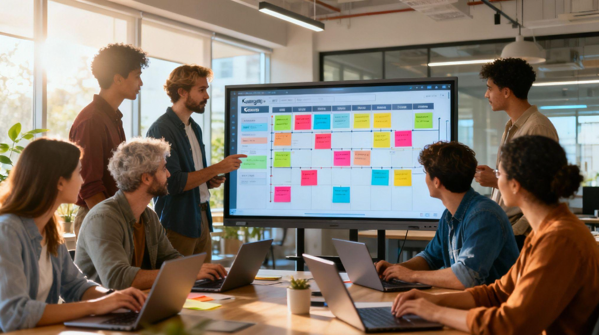
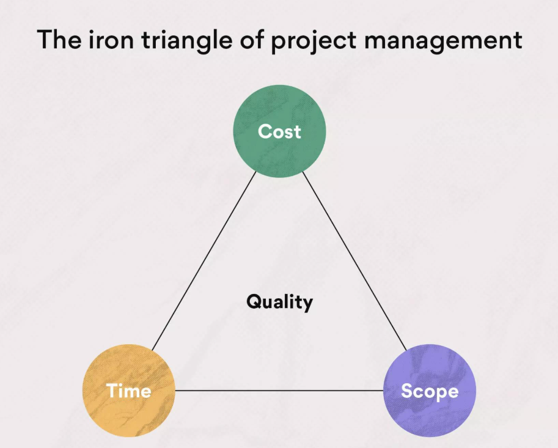
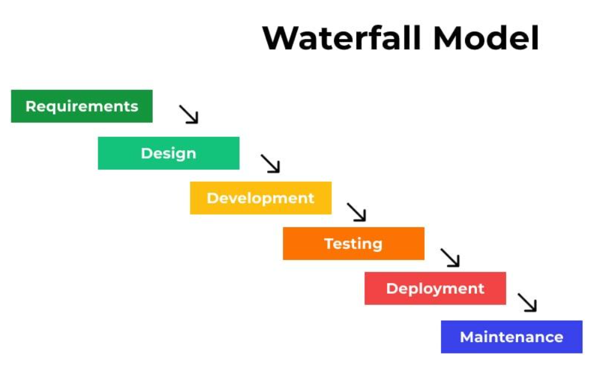
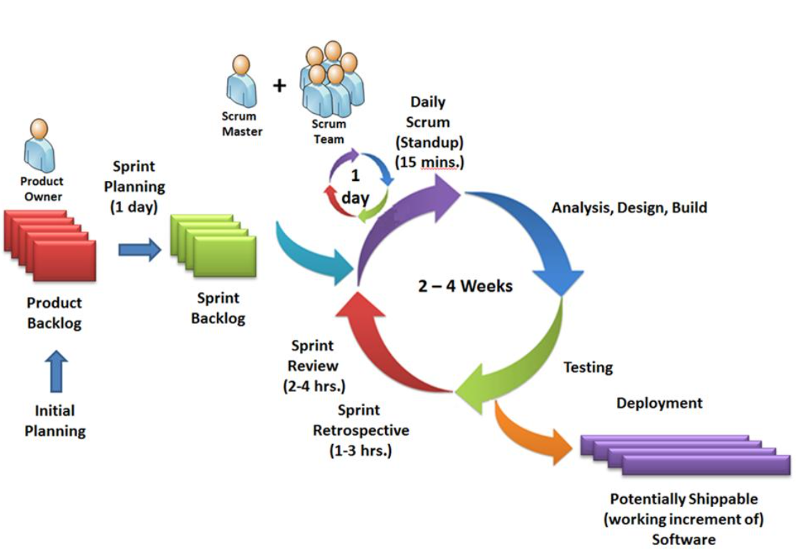
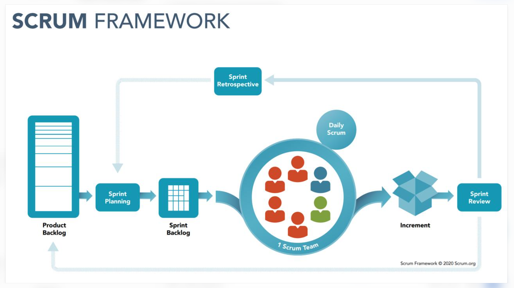
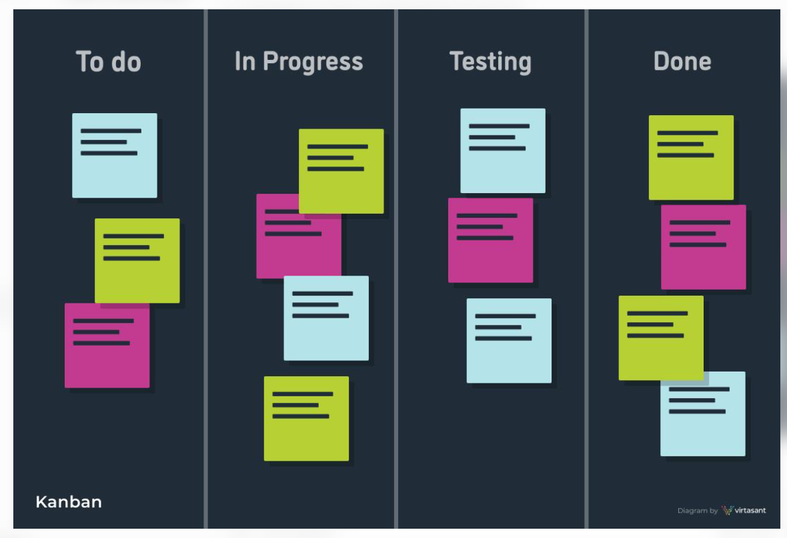
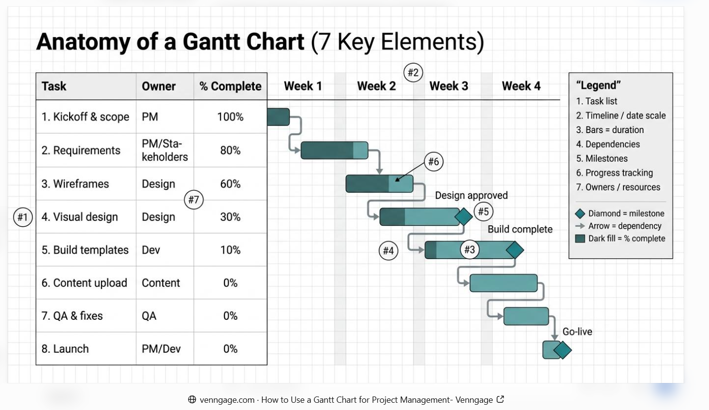
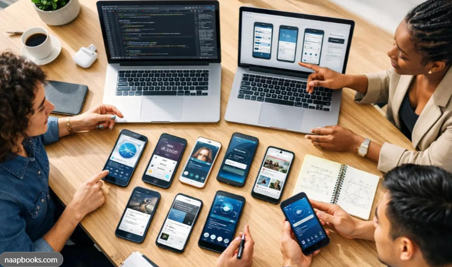

# Project Management (ការគ្រប់គ្រងគម្រោង)

Project Management is an important skill in IT, software development, business, engineering, construction, and many other industries.

It helps you plan, organize, manage, and successfully complete projects.

## 1. What Is Project Management?


**Definition:**

Project Management is the process of planning, organizing, executing, monitoring, and controlling resources and activities to achieve specific project objectives within a defined time, budget, and scope.

In simple English:

Project Management means managing a project from beginning to end to make sure it is completed successfully.

**Khmer explanation:**

Project Management (ការគ្រប់គ្រងគម្រោង) គឺជាដំណើរការនៃការរៀបចំផែនការ ចាត់ចែងការងារ គ្រប់គ្រងធនធាន តាមដាន និងត្រួតពិនិត្យការងារ ដើម្បីឱ្យគម្រោងសម្រេចបានជោគជ័យតាមពេលវេលា ថវិកា និងគោលដៅដែលបានកំណត់។

## 2. What Is a Project?

A **Project** is a temporary activity or group of activities created to produce a unique product, service, or result.

A project has:

- A beginning date.
- An ending date.
- Specific objectives.
- A defined scope.
- Required resources.
- A budget.
- Expected results.

### Examples of Projects

| Project | Expected result |
|---|---|
| E-commerce Application | An online shopping application |
| POS System | A point-of-sale management system |
| University Website | A website for a university |
| Hospital Management System | A system for managing hospital operations |
| Network Installation | A working computer network |
| Mobile Banking App | A mobile banking application |

**Important:** A project is temporary, but the product or system created by the project may continue operating for many years.

## 3. Main Objectives of Project Management

1. Complete the project on time.
2. Control project costs.
3. Deliver the expected quality.
4. Achieve project goals.
5. Manage people and resources.
6. Reduce risks and problems.
7. Communicate effectively.
8. Satisfy customers and stakeholders.

## 4. The Project Management Triangle


The **Triple Constraint**, also known as the Project Management Triangle, contains three major constraints.


https://asana.com/resources/project-management-triangle
| Constraint | Meaning | Example |
|---|---|---|
| Scope | What must be delivered | Build 10 application features |
| Time | How long the project takes | Complete within 3 months |
| Cost | How much money is required | Budget $5,000 |

**Quality** is affected by how these constraints are managed.

Example:

- Scope: 10 features.
- Time: 3 months.
- Cost: $5,000.
- Quality: Secure, responsive, and reliable application.

If the customer requests additional features without changing the deadline or budget, the project may become difficult to complete successfully.

## 5. The Five Project Management Process Groups

### 5.1 Initiating (ចាប់ផ្តើមគម្រោង)

Define the project, its purpose, objectives, and stakeholders.

### 5.2 Planning (រៀបចំផែនការ)

Decide what to do, who will do it, when it will happen, and how much it will cost.

### 5.3 Executing (អនុវត្តគម្រោង)

Perform the planned activities and coordinate the project team.

### 5.4 Monitoring and Controlling (តាមដាន និងត្រួតពិនិត្យ)

Track progress, manage changes, identify problems, and control costs and quality.

### 5.5 Closing (បញ្ចប់គម្រោង)

Complete the work, deliver the result, obtain acceptance, and document lessons learned.

These five process groups describe project management activities. They are not necessarily five strictly separate chronological stages; many activities overlap.

## 6. Project Management Methodologies

### 6.1 Waterfall Methodology



https://www.wallarm.com/what/what-is-a-systems-development-life-cycle-sdlc

Waterfall is a traditional project management approach in which work moves through sequential phases.

**Main phases:**

1. Requirements gathering.
2. System design.
3. Development.
4. Testing.
5. Deployment.
6. Maintenance.

**Advantages:**

- Easy to understand.
- Clear project stages.
- Easy to document.
- Suitable for projects with stable requirements.

**Disadvantages:**

- Difficult to change requirements.
- Customer feedback may come late.
- Problems may be discovered late.

**Example:** Developing a university system with clearly defined requirements and an agreed project plan.

### 6.2 Agile Methodology



https://www.devmedia.com.br/gerenciamento-de-projetos-com-scrum-e-o-software-agilo/31690

Agile focuses on flexibility, collaboration, continuous feedback, and delivering work in small increments.

**Main activities:**

1. Plan.
2. Design.
3. Develop.
4. Test.
5. Review.
6. Improve.
7. Repeat.

**Advantages:**

- Flexible requirements.
- Frequent customer feedback.
- Continuous improvement.
- Early delivery of working features.

**Disadvantages:**

- Requires frequent communication.
- Scope can change frequently.
- Requires active team participation.

**Example:** Developing an e-commerce application by releasing login, products, cart, checkout, and payment features in separate iterations.

### 6.3 Scrum Framework



https://www.scrum.org/resources/blog/que-es-scrum

Scrum is an Agile framework that helps teams manage complex work through short periods called **Sprints**.

A Sprint commonly lasts 1–4 weeks.

**Important Scrum components:**

| Component | Explanation |
|---|---|
| Product Backlog | List of all requested product work |
| Sprint Backlog | Work selected for the current Sprint |
| Sprint | Fixed-length development period |
| Daily Scrum | Short daily team coordination meeting |
| Sprint Review | Demonstrate completed work |
| Sprint Retrospective | Discuss improvements for the next Sprint |

**Three Scrum accountabilities:**

- **Product Owner:** Maximizes product value and manages Product Backlog effectiveness.
- **Scrum Master:** Helps establish Scrum and improve team effectiveness.
- **Developers:** Create a usable product increment.

### 6.4 Kanban Method

https://www.virtasant.com/blog/sdlc-methodologies?utm_source=chatgpt.com

Kanban is a visual method for managing work and improving workflow.

A basic Kanban board has four columns:

| To Do | In Progress | Testing | Done |
|---|---|---|---|
| Login page | Product page | Signup | Database |
| Cart page | Search | Checkout | Homepage |
| Payment | Profile | | |

**Advantages:**

- Easy to understand.
- Visual task tracking.
- Helps identify bottlenecks.
- Supports continuous workflow.

**Example:** Managing daily development tasks for a Flutter application.

### 6.5 Comparison of Methodologies

| Methodology | Main focus | Best suited for |
|---|---|---|
| Waterfall | Sequential phases | Stable requirements |
| Agile | Flexibility and iteration | Changing requirements |
| Scrum | Sprint-based teamwork | Complex product development |
| Kanban | Continuous workflow | Ongoing tasks and support |

**Important:** Agile is a broader approach, Scrum is an Agile framework, and Kanban is a workflow management method.

## 7. Project Management Knowledge Areas

| Knowledge area | What it manages |
|---|---|
| Integration Management | Coordinates all project activities |
| Scope Management | Controls project requirements and work |
| Schedule Management | Manages project timelines |
| Cost Management | Controls the project budget |
| Quality Management | Ensures deliverables meet requirements |
| Resource Management | Manages people and other resources |
| Communications Management | Manages project information |
| Risk Management | Identifies and responds to risks |
| Procurement Management | Manages external purchases and services |
| Stakeholder Management | Manages stakeholder expectations |

These are the traditional ten knowledge areas from the PMBOK Guide Sixth Edition. Newer PMI guidance also emphasizes principles, performance domains, and tailoring rather than treating these areas as a rigid checklist.

## 8. Important Project Management Documents

| Document | Purpose |
|---|---|
| Project Charter | Formally authorizes the project |
| Business Case | Explains why the project is needed |
| Project Proposal | Presents the project idea and solution |
| Project Management Plan | Explains how the project will be managed |
| Project Scope Statement | Defines project boundaries and deliverables |
| Work Breakdown Structure (WBS) | Breaks the project into smaller tasks |
| Project Schedule | Defines tasks, dates, and durations |
| Budget Plan | Estimates project costs |
| Risk Register | Records risks and responses |
| Communication Plan | Defines how information is shared |
| Status Report | Reports project progress |
| Change Request | Documents proposed project changes |
| Project Closure Report | Summarizes project completion |

### 8.1 Work Breakdown Structure (WBS)

WBS divides a large project into smaller, manageable components.

**Example: E-commerce Application**

```text
E-commerce Application
|
|-- 1. Planning
|   |-- Requirements
|   |-- Project scope
|   |-- Budget
|
|-- 2. Design
|   |-- UI/UX
|   |-- Database
|   |-- Architecture
|
|-- 3. Development
|   |-- Authentication
|   |-- Products
|   |-- Cart and orders
|
|-- 4. Testing
|   |-- Unit testing
|   |-- Integration testing
|   |-- User acceptance testing
|
|-- 5. Deployment
|   |-- Server setup
|   |-- Release
|   |-- Configuration
|
|-- 6. Maintenance
    |-- Bug fixing
    |-- Monitoring
    |-- Updates
```

The purpose of WBS is to make large projects easier to understand, estimate, assign, and control.

## 9. Project Management Roles and Responsibilities

| Role | Responsibility |
|---|---|
| Project Sponsor | Provides authority, support, and funding |
| Project Manager | Plans and manages the project |
| Product Owner | Defines product priorities and value |
| Business Analyst | Analyzes business requirements |
| UI/UX Designer | Designs user experience and interfaces |
| Software Developer | Builds software features |
| QA Engineer | Tests software quality |
| DevOps Engineer | Manages deployment and infrastructure |
| Stakeholder | Has an interest in or is affected by the project |
| End User | Uses the final product |

### What Does a Project Manager Do Every Day?

1. Reviews project progress.
2. Assigns and coordinates tasks.
3. Communicates with team members.
4. Organizes meetings.
5. Tracks deadlines.
6. Manages project risks.
7. Reports progress to stakeholders.
8. Resolves project issues.
9. Controls scope and budget.
10. Ensures the project meets its objectives.

## 10. Project Management Tools

### 10.1 Trello

Good for beginners and visual task management.

- To Do → Doing → Done.
- Website: https://trello.com/

### 10.2 Jira

Suitable for Agile and Scrum software development teams.

- Sprints, backlog, issues, and reports.
- Website: https://www.atlassian.com/software/jira

### 10.3 Asana

Useful for task management and team collaboration.

- Website: https://asana.com/

### 10.4 Microsoft Project

Useful for project schedules, dependencies, and resource management.

- Website: https://www.microsoft.com/en-us/microsoft-365/planner/microsoft-project

### 10.5 Notion

Useful for project documentation, notes, task databases, and knowledge management.

- Website: https://www.notion.com/

## 11. Project Planning and Scheduling Techniques

### 11.1 Gantt Chart



https://venngage.com/blog/gantt-chart-project-management/?utm_source=chatgpt.com

A Gantt Chart is a visual project schedule that shows:

- Project tasks.
- Start dates.
- End dates.
- Task durations.
- Dependencies.
- Milestones.
- Project progress.

**Example:**

| Task | Start | Duration |
|---|---|---|
| Requirements | Week 1 | 1 week |
| UI/UX Design | Week 2 | 2 weeks |
| Backend Development | Week 3 | 3 weeks |
| Frontend Development | Week 3 | 4 weeks |
| Testing | Week 7 | 1 week |
| Deployment | Week 8 | 1 week |

### 11.2 Milestones

A milestone is an important event or achievement in a project.

Examples:

- Requirements approved.
- UI/UX design completed.
- Database completed.
- First application version released.
- Testing completed.
- Project delivered.

### 11.3 Task Dependencies

Task dependencies describe relationships between project activities.

| Type | Meaning |
|---|---|
| Finish to Start (FS) | Task B starts after Task A finishes |
| Start to Start (SS) | Task B starts after Task A starts |
| Finish to Finish (FF) | Task B finishes after Task A finishes |
| Start to Finish (SF) | Task B finishes after Task A starts |

Example: You must finish database design before starting database implementation. This is a Finish-to-Start dependency.

### 11.4 Critical Path Method (CPM)

The Critical Path Method identifies the longest sequence of dependent activities that determines the shortest possible project completion time.

**Example:**

```text
Task A (2 days) -> Task B (3 days) -> Task C (2 days)

Total duration = 7 days
```

If these tasks are dependent and have no available float, delaying any one of them delays the entire project.

## 12. Project Risk Management

Risk Management is the process of identifying, analyzing, and responding to uncertainties that may affect project objectives.

### Types of Project Risks

| Risk | Example |
|---|---|
| Technical Risk | Application crashes |
| Financial Risk | Project budget increases |
| Schedule Risk | Development takes longer |
| Resource Risk | Developer leaves the team |
| Security Risk | Customer information is exposed |
| Business Risk | Customer requirements change |

### Risk Management Process

1. Identify risks.
2. Analyze risks.
3. Prioritize risks.
4. Plan risk responses.
5. Monitor risks.

### Risk Assessment Matrix

| Probability / Impact | Low impact | Medium impact | High impact |
|---|---|---|---|
| Low probability | Low | Low | Medium |
| Medium probability | Low | Medium | High |
| High probability | Medium | High | Critical |

**Example:**

Risk: The payment API may not work correctly.

- Probability: Medium.
- Impact: High.
- Response: Test the API early and prepare a backup payment process.

### Four Common Risk Response Strategies

- **Avoid:** Change the plan to eliminate the threat.
- **Mitigate:** Reduce the probability or impact.
- **Transfer:** Shift responsibility or financial consequences to another party, such as through insurance.
- **Accept:** Acknowledge the risk and prepare a response if needed.

## 13. Project Budget and Cost Management

Cost Management ensures that a project can be completed within its approved budget.

### Example: E-commerce Project Budget

| Expense | Estimated cost |
|---|---:|
| UI/UX Design | $500 |
| Frontend Development | $1,500 |
| Backend Development | $1,500 |
| Database and Hosting | $300 |
| Testing | $400 |
| Deployment | $300 |
| Contingency Reserve | $500 |
| **Total** | **$5,000** |

### Important Cost Terms

- **Budget:** The approved amount of money.
- **Cost Estimation:** Predicting the project expenses.
- **Actual Cost:** Money actually spent.
- **Cost Variance:** Difference between planned and actual costs.
- **Contingency Reserve:** Budget set aside for identified risks.

Formula:

```text
Cost Variance (CV) = Earned Value (EV) - Actual Cost (AC)
```

A negative cost variance means the project has spent more than the value of work completed.

## 14. Project Monitoring and Performance Measurement

Project Managers must measure project performance to understand whether the project is progressing successfully.

### Important KPIs (Key Performance Indicators)

| KPI | What it measures |
|---|---|
| Schedule Variance | Difference between planned and earned work value |
| Cost Variance | Cost performance |
| Task Completion Rate | Percentage of completed tasks |
| Defect Rate | Number of software defects |
| Team Productivity | Work completed by the team |
| Customer Satisfaction | Customer experience |
| On-Time Delivery | Whether deadlines are achieved |

### Earned Value Management (EVM)

Earned Value Management helps measure project performance using three important values:

| Term | Meaning |
|---|---|
| PV (Planned Value) | Budgeted value of scheduled work |
| EV (Earned Value) | Budgeted value of completed work |
| AC (Actual Cost) | Actual cost of completed work |

**Important formulas:**

```text
Schedule Variance (SV) = EV - PV

Cost Variance (CV) = EV - AC

Schedule Performance Index (SPI) = EV / PV

Cost Performance Index (CPI) = EV / AC
```

**Interpretation:**

- SPI greater than 1: Ahead of schedule.
- SPI less than 1: Behind schedule.
- CPI greater than 1: Spending efficiently.
- CPI less than 1: Spending more than the earned value.

## 15. Communication and Stakeholder Management

Communication is essential because projects involve multiple people and organizations.

### Types of Project Communication

1. Team meetings.
2. Daily progress updates.
3. Email communication.
4. Project status reports.
5. Customer presentations.
6. Technical documentation.
7. Project review meetings.

### Stakeholder Examples

For an e-commerce project:

| Stakeholder | Interest |
|---|---|
| Business Owner | Business success |
| Project Sponsor | Budget and project results |
| Project Manager | Project completion |
| Developers | Technical implementation |
| Customers | Application usability |
| Payment Provider | Payment integration |
| Delivery Partner | Order delivery |

A Project Manager must understand stakeholder expectations and communicate important information clearly.

## 16. Quality Management

Quality Management ensures that the project deliverables meet agreed requirements and expectations.

For software projects, quality can include:

- Functionality.
- Performance.
- Security.
- Reliability.
- Usability.
- Maintainability.
- Compatibility.

### Software Quality Activities

| Activity | Purpose |
|---|---|
| Quality Planning | Define quality requirements |
| Quality Assurance | Improve processes to prevent defects |
| Quality Control | Inspect and test deliverables |
| User Acceptance Testing | Confirm the system meets user needs |

Example: Before releasing an e-commerce application, the team tests login, registration, products, shopping cart, checkout, payment, and order tracking.

## 17. Real-World IT Project Management Example


https://naapbooks.com/insights/blog/mobile-application-development-services-for-startups-enterprises/?utm_source=chatgpt.com

Imagine you are a Project Manager responsible for developing an e-commerce application.

### Project Information

| Item | Description |
|---|---|
| Project Name | OUSA E-commerce Application |
| Project Type | Mobile and Web Application |
| Methodology | Agile Scrum |
| Estimated Duration | 12 Weeks |
| Team Size | 5 Members |
| Estimated Budget | $5,000 |
| Technology | Flutter, Node.js, Express.js, PostgreSQL |
| Project Manager | You |

### Phase 1: Project Initiation

Activities:

1. Identify the business problem.
2. Define project objectives.
3. Identify stakeholders.
4. Prepare the project proposal.
5. Obtain project approval.

**Expected output:** Project Charter.

### Phase 2: Project Planning

Activities:

1. Collect business requirements.
2. Define project scope.
3. Create the WBS.
4. Estimate the project budget.
5. Prepare the project schedule.
6. Assign team members.
7. Identify project risks.

**Expected output:** Project Management Plan.

### Phase 3: Project Execution

Activities:

1. Design application interfaces.
2. Design database tables.
3. Develop authentication.
4. Develop product management.
5. Develop shopping cart.
6. Develop checkout.
7. Integrate payment.
8. Develop order management.

**Expected output:** Working application features.

### Phase 4: Monitoring and Controlling

Activities:

1. Monitor development progress.
2. Review completed tasks.
3. Test application features.
4. Manage technical problems.
5. Control project costs.
6. Review project risks.
7. Communicate with stakeholders.

**Expected output:** Progress reports and approved changes.

### Phase 5: Project Closing

Activities:

1. Complete final testing.
2. Fix critical bugs.
3. Deploy the application.
4. Deliver documentation.
5. Obtain customer acceptance.
6. Conduct a final review.
7. Document lessons learned.

**Expected output:** Completed and accepted e-commerce application.

## 18. Important Skills for a Professional Project Manager

| Skill | Explanation |
|---|---|
| Leadership | Guide and motivate the team |
| Communication | Share information clearly |
| Planning | Organize project activities |
| Time Management | Manage deadlines |
| Problem Solving | Resolve project issues |
| Decision Making | Make appropriate decisions |
| Negotiation | Manage agreements and expectations |
| Risk Management | Handle project uncertainties |
| Budget Management | Control project expenses |
| Technical Knowledge | Understand the project's technology |

**Important:** You do not need to be the best programmer to become an IT Project Manager, but you should understand software development, databases, APIs, infrastructure, and technical challenges well enough to coordinate the team.

## 19. Project Management Certifications

### 19.1 CAPM – Certified Associate in Project Management

**Level:** Beginner

- Suitable for students and beginners.
- Teaches project management fundamentals.
- Offered by the Project Management Institute (PMI).

Official information: https://www.pmi.org/certifications/certified-associate-capm

### 19.2 PMP – Project Management Professional

**Level:** Professional

- For experienced project managers.
- Covers predictive, Agile, and hybrid approaches.
- Requires qualifying project management experience.

Official information: https://www.pmi.org/certifications/project-management-pmp

### 19.3 PSM – Professional Scrum Master

**Focus:** Agile / Scrum

- Focuses on Scrum knowledge.
- Teaches Scrum Master responsibilities.
- Useful for software development teams.

Official information: https://www.scrum.org/assessments/professional-scrum-master-i-certification

### 19.4 PRINCE2 – Projects IN Controlled Environments

**Focus:** Structured methodology

- Focuses on structured project governance.
- Covers project roles, stages, and controls.

Official information: https://www.peoplecert.org/

## 20. Complete Project Management Learning Roadmap

### Phase 1: Project Management Fundamentals

- What is a project?
- What is Project Management?
- Project objectives.
- Project lifecycle.
- Project constraints.

### Phase 2: Project Planning

- Project Charter.
- Project Scope.
- WBS.
- Project Scheduling.
- Gantt Charts.
- Budget Planning.

### Phase 3: Project Execution

- Team management.
- Task assignment.
- Resource management.
- Communication.
- Stakeholder management.

### Phase 4: Project Monitoring and Control

- Project KPIs.
- Risk Management.
- Quality Management.
- Cost Control.
- Change Management.
- Performance Reporting.

### Phase 5: Project Management Methodologies

- Waterfall.
- Agile.
- Scrum.
- Kanban.
- Hybrid Project Management.

### Phase 6: Professional Tools

- Microsoft Project.
- Jira.
- Trello.
- Asana.
- Notion.
- Microsoft Excel.

### Phase 7: Advanced Project Management

- Critical Path Method.
- Earned Value Management.
- Resource Optimization.
- Portfolio Management.
- Program Management.
- Project Governance.

### Phase 8: Professional Practice

- Manage a real project.
- Create project documentation.
- Lead a project team.
- Present project results.
- Prepare for CAPM or PMP certification.

## 21. Project Management vs. Program Management vs. Portfolio Management

| Concept | Meaning | Example |
|---|---|---|
| Project Management | Manages one project | Build an e-commerce application |
| Program Management | Coordinates related projects | Manage e-commerce, POS, and inventory projects |
| Portfolio Management | Manages a collection of projects and programs to achieve strategic objectives | Manage all IT investments of a company |

## 22. Test Your Project Management Knowledge

### Question 1

**What is the main purpose of Project Management?**

- A. Only writing software
- B. Planning and managing projects to achieve objectives
- C. Only managing employees

**Correct answer: B.**

Explanation: Project Management coordinates scope, time, cost, resources, and quality to achieve objectives.

### Question 2

**Which methodology uses Sprints?**

- A. Waterfall
- B. Scrum
- C. Traditional sequential planning

**Correct answer: B.**

Explanation: Scrum organizes work into fixed-length Sprints.

### Question 3

**What does WBS stand for?**

- A. Work Breakdown Structure
- B. Web Business System
- C. Work Budget Schedule

**Correct answer: A.**

Explanation: WBS divides project scope into smaller manageable components.

### Question 4

**What is a Gantt Chart used for?**

- A. Database design
- B. Project scheduling and timelines
- C. Writing programming code

**Correct answer: B.**

Explanation: A Gantt Chart visually represents tasks, dates, durations, and dependencies.

### Question 5

**What is the main responsibility of a Project Manager?**

- A. Do every task personally
- B. Coordinate and manage the project
- C. Only write reports

**Correct answer: B.**

Explanation: The Project Manager coordinates people, activities, resources, risks, and progress.

## 23. Final Recommendation

For an IT student who wants to become a professional developer and eventually lead software projects, learn Project Management alongside programming.

Start with these five practical skills:

1. **Project Planning:** Know how to plan a project.
2. **Task Management:** Know how to divide and assign work.
3. **Agile and Scrum:** Understand how software teams work.
4. **Risk Management:** Know how to identify and solve problems.
5. **Communication:** Know how to work with developers, customers, and stakeholders.

### Your First Practical Project

Manage an E-commerce Application from project initiation to deployment.

Create the following documents:

- Project Charter.
- Work Breakdown Structure (WBS).
- Gantt Chart.
- Project Budget.
- Risk Register.
- Scrum Product Backlog.
- Final Project Report.

This will help you understand Project Management through real-world practice, not just theory.

---

## Key Takeaway

**Project Management = Planning + Organizing + Executing + Monitoring + Controlling + Closing.**

A successful Project Manager helps a team deliver the right result, at the right time, within the agreed budget and quality expectations.
